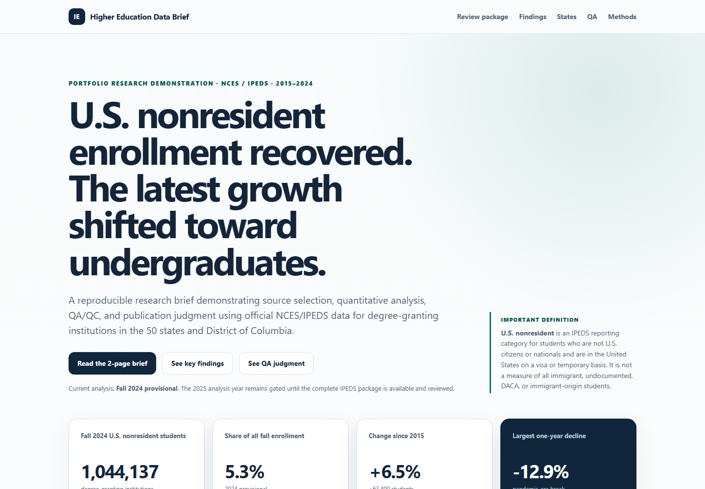

# U.S. Nonresident Students in Higher Education

Portfolio research project analyzing national and state-level enrollment trends for U.S. nonresident students in American higher education using the U.S. Department of Education's Integrated Postsecondary Education Data System (IPEDS).

The project is designed as a compact, reproducible research product rather than a generic dashboard. It emphasizes source quality, data definitions, QA/QC, methodological documentation, clear writing, and communication of limitations.



**Live publication:** https://joseph-th.github.io/higher_education_and_immigration_demo/

## Start here

For a quick review of the finished work:

1. [Live research publication](https://joseph-th.github.io/higher_education_and_immigration_demo/) - interactive national/state analysis, methods, QA, and public downloads.
2. [`deliverables/research_brief.pdf`](deliverables/research_brief.pdf) - three-page policy/research writing sample with findings, analyst QA decisions, and methods/source trail.
3. [`docs/POPULATION_CROSSWALK.md`](docs/POPULATION_CROSSWALK.md) - source-selection guide distinguishing IPEDS, immigrant-origin, SEVIS international, undocumented, pipeline, and refugee/asylee concepts.
4. [`docs/RECURRING_REPORT_REGISTER.md`](docs/RECURRING_REPORT_REGISTER.md) - portfolio operations model for partner intake, methodology-change review, QA, publication gating, and institutional-knowledge handoff across the three recurring reports named in the target role.
5. [`site/production-cycle.html`](site/production-cycle.html) - seven-stage partner-production control model with evidence-based gates plus a validated blank live-cycle log template.
6. [`site/research-library.html`](site/research-library.html) - searchable Research Library with population/topic, resource-type, publisher, and workflow-stage metadata.
7. [`site/publication-handoff.html`](site/publication-handoff.html) - pre-publication claim register tying public copy to analytical authority, source, QA gate, disclosure, and publication status.
8. [`site/data-governance.html`](site/data-governance.html) - executable public-release governance showing data minimization, artifact classification, and the exact public allowlist.
9. [`deliverables/ipeds_portfolio_analysis.xlsx`](deliverables/ipeds_portfolio_analysis.xlsx) - formula-driven Excel review workbook with state lookup, reconciliation, benchmark QA, and source metadata.
10. [`deliverables/management_briefing_deck.pptx`](deliverables/management_briefing_deck.pptx) - six-slide PowerPoint management briefing with KPI, trend, geography, driver, and QA views generated from validated outputs.
11. [`site/sql-analysis.html`](site/sql-analysis.html) - read-only SQLite query portfolio showing joins, grouping, CTEs, ranking, window functions, and independent reconciliation.
12. [`site/ad-hoc-analysis.html`](site/ad-hoc-analysis.html) - three explicitly simulated management questions showing a request-to-response workflow with source authority and reconciliation.
13. [`site/state-recovery.html`](site/state-recovery.html) - 2019-2024 state recovery decomposition by student level, institutional control, institution continuity, and concentration among leading institution contributors.
14. [`site/undergraduate-shift.html`](site/undergraduate-shift.html) - fixed 2023-2024 R01 baseline showing undergraduate growth breadth, institutional-control and continuity accounting, concentration, and the pre-specified next-release persistence rule.
15. [`site/private-nonprofit-growth.html`](site/private-nonprofit-growth.html) - 2015-2024 private-nonprofit institution contribution analysis with concentration metrics, student-level decomposition, and inherited latest-release QA gates.
16. [`site/qa-review.html`](site/qa-review.html) - complete 27-record high-priority latest-release QA review with evidence-backed publication dispositions and explicit claim holds.
17. [`site/medium-priority-review.html`](site/medium-priority-review.html) - complete 50-record medium-priority QA routing layer with four reason-derived evidence routes and candidate-directory overlap context, without inventing a new risk score or publication clearance.
18. [`site/medium-qa-review.html`](site/medium-qa-review.html) - evidence-backed review of all 50 medium-priority flags, with 5 bounded `safe_with_context` decisions, 45 holds, one public evidence source per row, and explicit next-release revalidation.
19. [`site/population-trends.html`](site/population-trends.html) and [`site/undocumented-pipeline.html`](site/undocumented-pipeline.html) - bounded population comparisons that preserve source-vintage, non-addability, ecological, stock/flow, and non-causal boundaries.
20. [`site/planning-scenarios.html`](site/planning-scenarios.html) - forecast-vs-actual backtest plus three non-predictive planning scenarios derived from transparent historical growth assumptions.
21. [`site/freshness-monitor.html`](site/freshness-monitor.html) - dated next-release readiness, source-review, and recurring-product trigger monitor that preserves the partial 2025 NCES package observation without treating it as permission to advance the analysis year.
22. [`site/candidate-directory-preflight.html`](site/candidate-directory-preflight.html) - bounded structural review of the available 2025 institutional directory/dictionary, including required-field continuity, eligible-frame continuity, archive hashes, and an explicit no-year-advance boundary.
23. [`site/candidate-directory-changes.html`](site/candidate-directory-changes.html) - institution-level candidate-directory QA queue separating structural frame entry/exit from shared control, state, and name changes while using current-year enrollment only to prioritize later review.
24. [`site/candidate-year-watchlist.html`](site/candidate-year-watchlist.html) - 226-UNITID carry-forward QA union combining the current high/medium review queue with candidate-directory structural changes and explicit next-release revalidation rules.
25. [`site/release-readiness.html`](site/release-readiness.html) - consolidated eight-gate control matrix separating current-publication readiness from permission to advance the IPEDS analysis year.
26. [`site/source-update-triage.html`](site/source-update-triage.html) - R07 source-change routing across all maintained Research Library resources, separating routine refreshes from methodology, research-question, governance, monitor-only, and archival paths.
27. [`docs/REVIEWER_GUIDE.md`](docs/REVIEWER_GUIDE.md) - evidence map from research responsibilities to specific files, scripts, and validation outputs.

The interactive publication is under [`site/`](site/); deployment instructions are in [`docs/DEPLOYMENT.md`](docs/DEPLOYMENT.md).

## Research question

How did fall enrollment of U.S. nonresident students change across the United States from 2015 through 2024, and how did those changes vary by state and student level?

## Outputs

- A polished static research brief in [`site/`](site/) with national, level, state, and institution views.
- Interactive charts and a state explorer designed for nontechnical readers.
- Reproducible source-data collection and transformation scripts.
- A transparent methodology and data-quality record.
- Downloadable analysis tables, source lineage, schema audit, and external benchmark audit.
- A generated latest-release review packet with reason-coded institution-level QA triage.
- A complete medium-priority QA routing layer that maps all 50 current medium rows to four existing-trigger evidence routes, quantifies mixed-direction movement, and surfaces candidate-directory overlap without adding a new score or publication disposition.
- An analyst-reviewed QA resolution log that documents evidence, disposition, and publication decisions for every current high-priority flag without rewriting source values.
- A separate medium-priority evidence-resolution log covering all 50 routed records, with 5 bounded contextual clearances and 45 institution-specific holds, while preserving IPEDS as the analytical authority.
- A standalone research memo in Markdown and HTML that combines validated findings, interpretation boundaries, and three evidence-backed analyst case studies.
- A reviewer-ready three-page PDF research brief generated from the validated memo, with a source/PDF SHA-256 manifest that detects stale publication copies.
- A generated stakeholder briefing note that translates validated findings into a concise management-facing update.
- A reviewer-ready Excel workbook with formula-driven KPIs, state lookup, reconciliation checks, benchmark QA, and source metadata.
- A six-slide PowerPoint management briefing generated from the validated outputs, with KPI, trend, geography, driver, and interpretation/QA views plus a source/builder freshness manifest.
- A six-query SQL analysis pack executed against an in-memory SQLite database rebuilt from validated CSV outputs, with query-level independent reconciliation checks.
- A three-case ad hoc analysis casebook that answers bounded simulated management questions from validated outputs and makes the source, calculation, reconciliation, and response explicit without inventing a requester or SLA.
- A state recovery decomposition that explains the 2019-2024 state split with exact student-level, institutional-control, and institution-continuity accounting, plus concentration among the leading institution contributors in each state's net direction.
- A fixed 2023-2024 R01 undergraduate-shift baseline that reconciles state, institutional-control, and institution-continuity movement, quantifies geographic and institution concentration, places the shift in the 2015-2024 annual history, and pre-specifies the next-release breadth test without claiming persistence early.
- A private-nonprofit growth concentration analysis that reconciles the sector's 2015-2024 change, separates undergraduate and graduate contributions, measures concentration against gross positive institution movement, and preserves current latest-release QA holds for named institutions.
- A bounded national population-trend comparison that keeps IPEDS U.S. nonresident, immigrant-origin, and undocumented higher-education measures separate, compares change only within method-compatible source segments, and blocks cross-population arithmetic.
- A bounded 2023 undocumented pipeline context that compares the ten states with explicit same-year high-school-graduate and higher-education estimates, measures geographic concentration, and explicitly prevents stock/annual-flow scale from being interpreted as a transition rate.
- A planning-scenario and variance artifact that backtests a simple historical-growth baseline against the known 2024 actual and presents three transparent 2025 planning cases without treating them as predictions.
- A dated release/freshness monitor that preserves the current four-file NCES next-year availability check, applies an explicit year-advance gate, and combines it with source-review dates and recurring-product monitoring triggers.
- A candidate-directory structural preflight that uses the already-available 2025 HD data/dictionary to verify the six current join/filter fields, 51-state/DC coverage, UNITID uniqueness, directory-eligible frame continuity, control changes, schema delta, and archive hashes without treating the partial package as a 2025 enrollment release.
- A hashed candidate-directory institution-change review covering all 154 affected UNITIDs, classifying frame entry/exit reasons and shared control/state/name changes, and attaching only current-year enrollment exposure so the eventual full-package QA pass can be prioritized without inventing 2025 enrollment values.
- A candidate-year QA carry-forward watchlist that reconciles 27 current high-priority rows, 50 medium-priority rows, and 154 candidate-directory structural changes to 226 unique UNITIDs, surfaces five medium/directory overlaps, carries both current evidence-review layers only as context, and requires prior publication decisions to be revalidated rather than inherited.
- A consolidated release-readiness matrix that combines analytical QA, benchmark, high- and medium-priority evidence review, publication handoff, public-release registration, presentation freshness, source routing, and candidate-year package status while keeping current-publication and year-advance decisions separate.
- A source-update triage register covering all 17 maintained Research Library sources with baseline routing, methodology-escalation triggers, new-research triggers, and a zero-inferred-deadline boundary.
- Fifty-one generated state/DC research profiles linked directly from the interactive state explorer.
- A structured population/source crosswalk covering IPEDS U.S. nonresident, immigrant-origin, SEVIS international, undocumented higher-education, undocumented high-school-graduate, and refugee/asylee research concepts.
- A relational recurring-report register for the three named research products, linked to the Research Library and population crosswalk rather than maintained as disconnected prose.
- A seven-stage production-cycle register that makes partner coordination inspectable as entry conditions, required records, blockers, exit conditions, and retained handoff evidence rather than narrative workflow prose alone.
- A blank 16-field production-cycle coordination log plus a validator that enforces report/stage foreign keys, controlled record types/materiality/status values, ISO dates, closure rules, and a nonpublic-by-default boundary for completed partner logs.
- A structured research agenda/data-needs register that separates immediately answerable IPEDS questions from work requiring partner or population-specific data.
- A structured Research Library describing source scope, update pattern, project use, and review date.
- A searchable public Research Library with population/topic tags and workflow-stage metadata, so related sources can be filtered without losing the structured CSV authority.
- A generated publication-handoff register that traces 17 public claims/controls to their analytical authority, Research Library source, QA gate, required disclosure, and publication decision, including the R01 fixed baseline, R04 non-addability/vintage gate, R06 stock-versus-flow boundary, R07 source-update routing control, R08 candidate-year QA carry-forward gate, and R09 medium-priority evidence-review gate.
- A governed public-release register covering 70 artifact families / 120 downloadable files, with a fail-closed allowlist that rejects unregistered files from `site/downloads/` and `site/data/`.
- An explicit data-minimization boundary: the current portfolio contains no person-level records or observed immigration-status field, and future restricted partner inputs are nonpublic by default.
- A documented annual update workflow and deployment path.
- Separate offline data validation and browser-level publication QA lanes.

## Data

Primary source: National Center for Education Statistics (NCES), Integrated Postsecondary Education Data System (IPEDS).

Initial source tables:

- `EF2015A` through `EF2024A`: Fall Enrollment by race/ethnicity, gender, attendance status, and student level.
- `HD2015` through `HD2024`: Institutional directory information used for institution name, state, and other institutional attributes.

Raw source files are downloaded directly from NCES and are intentionally excluded from Git because they are reproducible and comparatively large. A tracked source manifest records the source URL, file size, SHA-256 hash, and retrieval time for every downloaded archive.

## Reproduce the source-data collection

From the repository root:

```bash
python scripts/fetch_ipeds.py
```

The script downloads the official data archives and data dictionaries for 2015-2024, verifies that each response is a valid ZIP archive, extracts it under `data/raw/ipeds/`, and writes `data/source_manifest.csv`.

To reproduce the cross-year schema audit:

```bash
python -m pip install -r requirements.txt
python scripts/audit_ipeds_schema.py
```

The audit verifies the required enrollment and directory variables, confirms the aggregation labels used by the analysis, prefers revised historical CSVs when NCES provides them, and writes `data/schema_audit.csv`.

Build the normalized analysis outputs and public-site data:

```bash
python scripts/build_analysis.py
python scripts/build_sql_analysis.py
python scripts/build_ad_hoc_analysis.py
python scripts/build_state_recovery_analysis.py
python scripts/build_undergraduate_shift_baseline.py
python scripts/build_planning_scenarios.py
python scripts/build_candidate_directory_preflight.py
python scripts/build_candidate_directory_change_review.py
python scripts/build_update_review.py
python scripts/build_medium_priority_review.py
python scripts/build_qa_resolution_log.py
python scripts/build_medium_qa_resolution_log.py
python scripts/build_candidate_year_qa_watchlist.py
python scripts/build_freshness_monitor.py
python scripts/build_private_nonprofit_analysis.py
python scripts/build_research_library.py
python scripts/build_source_update_triage.py
python scripts/build_undocumented_pipeline.py
python scripts/build_population_crosswalk.py
python scripts/build_population_trends.py
python scripts/build_recurring_report_register.py
python scripts/validate_production_cycle_log.py
python scripts/build_production_cycle.py
python scripts/build_research_agenda.py
python scripts/summarize_findings.py
python scripts/validate_benchmarks.py
python scripts/build_state_profiles.py
python scripts/build_briefing_note.py
python scripts/build_research_memo.py
python scripts/build_publication_handoff.py
python scripts/build_release_readiness.py
python scripts/build_data_governance.py
python scripts/build_site_data.py
```

The public analysis uses degree-granting institutions in the IPEDS First Look/Digest Title IV universe (`DEGGRANT=1` and `PSET4FLG` in `1,3`) located in the 50 states and District of Columbia. This selection makes the headline national total directly benchmarkable against NCES Digest tables.

For the complete offline rebuild and validation path, run:

```bash
python scripts/validate_project.py
```

That command compiles the Python code, reruns the schema audit, rebuilds all derived data, reruns 24 NCES Digest consistency checks, regenerates the public site data, and runs the repository test suite.

The PDF brief is a downstream publication artifact rather than an analytical input. When the research memo changes, regenerate it after installing the optional Playwright dependency:

```bash
python -m pip install -r requirements-dev.txt
python -m playwright install chromium
python scripts/build_pdf_brief.py
python scripts/validate_project.py
```

`deliverables/research_brief_manifest.json` records the exact memo SHA-256 used to create the PDF. Repository validation fails if the committed PDF no longer matches the current generated memo.

The PowerPoint deck is also a downstream publication artifact. After installing `requirements-dev.txt`, regenerate it with:

```bash
python scripts/build_management_deck.py
python scripts/validate_project.py
```

`deliverables/management_briefing_manifest.json` binds the six-slide PPTX to the current deck builder and validated CSV/JSON sources by SHA-256.

For browser-level publication QA, install the optional development dependency and Chromium once, then run:

```bash
python -m pip install -r requirements-dev.txt
python -m playwright install chromium
python scripts/browser_smoke.py
```

The browser smoke test serves the built site on an ephemeral local port, renders desktop and mobile viewports, checks calculated values and interactive elements, verifies public downloads, detects JavaScript/console errors, and checks for unintended page-level horizontal overflow.

Live source-health checks remain separate from offline validation:

```bash
python scripts/check_for_new_release.py
python scripts/check_candidate_directory.py
python scripts/check_research_library.py
python scripts/check_population_crosswalk.py
python scripts/check_qa_evidence.py
```

The live checks verify the maintained Research Library, the population-crosswalk methodology sources, and the external evidence links used by the manual QA resolution layer. They are intentionally separate from the offline reproducibility build. Script-blocking HTTP 401/403 responses are surfaced as access restrictions requiring manual browser review rather than misclassified as dead links.

## Documentation

- [`docs/PROJECT_BRIEF.md`](docs/PROJECT_BRIEF.md): scope, audience, questions, and deliverables.
- [`docs/DATA_SOURCES.md`](docs/DATA_SOURCES.md): source inventory and release notes.
- [`docs/METHODOLOGY.md`](docs/METHODOLOGY.md): definitions, analytic unit, QA/QC plan, and limitations.
- [`docs/POPULATION_CROSSWALK.md`](docs/POPULATION_CROSSWALK.md): generated source-selection crosswalk for distinct immigration-related student populations.
- [`docs/RECURRING_REPORT_REGISTER.md`](docs/RECURRING_REPORT_REGISTER.md): recurring-report intake, methodology review, QA gate, publication, and handoff model for the three products named in the target role.
- [`docs/PRODUCTION_CYCLE.md`](docs/PRODUCTION_CYCLE.md): generated seven-stage partner-production controls, product kickoff packet, and live-cycle log handling rules.
- [`docs/VARIABLE_MAPPING.md`](docs/VARIABLE_MAPPING.md): verified cross-year variables and aggregation codes.
- [`docs/DATA_DICTIONARY.md`](docs/DATA_DICTIONARY.md): definitions for generated analysis and audit outputs.
- [`docs/VALIDATION.md`](docs/VALIDATION.md): implemented QA checks and independent NCES benchmark.
- [`docs/FINDINGS.md`](docs/FINDINGS.md): current analytical findings with exact supporting figures.
- [`docs/LATEST_UPDATE_REVIEW.md`](docs/LATEST_UPDATE_REVIEW.md): generated review of the newest annual release and its QA queue.
- [`docs/QA_RESOLUTION_LOG.md`](docs/QA_RESOLUTION_LOG.md): evidence-backed analyst dispositions for the complete current high-priority annual QA queue.
- [`docs/MEDIUM_PRIORITY_REVIEW.md`](docs/MEDIUM_PRIORITY_REVIEW.md): current medium-priority QA routing by existing trigger type, mixed-direction accounting, candidate-directory overlap, and evidence-review boundary.
- [`docs/MEDIUM_QA_RESOLUTION_LOG.md`](docs/MEDIUM_QA_RESOLUTION_LOG.md): evidence-backed analyst dispositions for all 50 current medium-priority QA records, including scope caveats and next-release revalidation.
- [`docs/RESEARCH_MEMO.md`](docs/RESEARCH_MEMO.md): concise reviewer-facing writing sample built from validated findings and QA decisions.
- [`docs/BRIEFING_NOTE.md`](docs/BRIEFING_NOTE.md): generated stakeholder briefing with implications, monitoring questions, and interpretation boundaries.
- [`docs/EXCEL_WORKBOOK.md`](docs/EXCEL_WORKBOOK.md): workbook contents, authority boundaries, QA features, and maintenance notes.
- [`docs/POWERPOINT_DECK.md`](docs/POWERPOINT_DECK.md): management-deck contents, authority boundary, freshness manifest, and rebuild instructions.
- [`docs/SQL_ANALYSIS.md`](docs/SQL_ANALYSIS.md): generated SQL query catalog, sample results, and independent reconciliation checks.
- [`docs/AD_HOC_ANALYSIS.md`](docs/AD_HOC_ANALYSIS.md): simulated one-off management questions, compact answers, source authorities, and case-level reconciliation checks.
- [`docs/STATE_RECOVERY_ANALYSIS.md`](docs/STATE_RECOVERY_ANALYSIS.md): 2019-2024 state recovery decomposition, institution concentration, reconciliation controls, and interpretation boundaries.
- [`docs/UNDERGRADUATE_SHIFT_BASELINE.md`](docs/UNDERGRADUATE_SHIFT_BASELINE.md): fixed 2023-2024 R01 baseline, annual context, breadth/concentration measures, and next-release persistence rule.
- [`docs/PRIVATE_NONPROFIT_GROWTH.md`](docs/PRIVATE_NONPROFIT_GROWTH.md): 2015-2024 private-nonprofit institution-contribution concentration analysis with student-level reconciliation and latest-release QA gates.
- [`docs/POPULATION_TREND_COMPARISON.md`](docs/POPULATION_TREND_COMPARISON.md): bounded national comparison of IPEDS U.S. nonresident, immigrant-origin, and undocumented higher-education measures with explicit source-vintage breaks and non-addability rules.
- [`docs/UNDOCUMENTED_PIPELINE_CONTEXT.md`](docs/UNDOCUMENTED_PIPELINE_CONTEXT.md): bounded 2023 state context comparing undocumented annual high-school graduate flow with undocumented higher-education enrollment stock without treating their ratio as a transition rate.
- [`docs/PLANNING_SCENARIOS.md`](docs/PLANNING_SCENARIOS.md): forecast-vs-actual backtest, data-derived planning scenarios, assumptions, and interpretation boundary.
- [`docs/FRESHNESS_MONITOR.md`](docs/FRESHNESS_MONITOR.md): dated next-release availability, year-advance gate, source-review state, and recurring-product monitoring triggers.
- [`docs/CANDIDATE_DIRECTORY_PREFLIGHT.md`](docs/CANDIDATE_DIRECTORY_PREFLIGHT.md): bounded 2025 directory/dictionary compatibility review, frame continuity, hashes, schema delta, and no-year-advance boundary.
- [`docs/CANDIDATE_DIRECTORY_CHANGE_REVIEW.md`](docs/CANDIDATE_DIRECTORY_CHANGE_REVIEW.md): hashed institution-level candidate-directory entry/exit and attribute-change queue with current-year exposure and no-future-enrollment interpretation boundary.
- [`docs/CANDIDATE_YEAR_QA_WATCHLIST.md`](docs/CANDIDATE_YEAR_QA_WATCHLIST.md): reconciled current/candidate institution review union with cross-signal overlaps, carry-forward actions, and explicit revalidation boundaries.
- [`docs/SOURCE_UPDATE_TRIAGE.md`](docs/SOURCE_UPDATE_TRIAGE.md): R07 source-change routing with complete Research Library coverage, escalation rules, and portfolio/non-affiliation boundaries.
- [`docs/RESEARCH_AGENDA.md`](docs/RESEARCH_AGENDA.md): prioritized research questions, data needs, methods, outputs, and decision rules.
- [`docs/RESEARCH_LIBRARY.md`](docs/RESEARCH_LIBRARY.md): generated human-readable view of the structured source library.
- [`docs/PUBLICATION_HANDOFF.md`](docs/PUBLICATION_HANDOFF.md): generated pre-publication claim/QA/disclosure handoff register.
- [`docs/RELEASE_READINESS.md`](docs/RELEASE_READINESS.md): consolidated current-release and candidate-year control matrix with explicit blocking scope.
- [`docs/DATA_GOVERNANCE.md`](docs/DATA_GOVERNANCE.md): public-release allowlist, data-minimization rules, and restricted-data handling boundary.
- [`docs/REVIEWER_GUIDE.md`](docs/REVIEWER_GUIDE.md): short portfolio walkthrough and evidence map for hiring/research reviewers.
- [`docs/UPDATE_PLAYBOOK.md`](docs/UPDATE_PLAYBOOK.md): annual release/update procedure.
- [`docs/DATA_CALENDAR.md`](docs/DATA_CALENDAR.md): current coverage and next-release monitoring.
- [`docs/DEPLOYMENT.md`](docs/DEPLOYMENT.md): current GitHub Pages publication procedure plus optional Cloudflare Pages setup.
- [`data/README.md`](data/README.md): data directory conventions.

## Current status

The research brief is built locally and passes both the complete offline validation path and browser publication QA at desktop and 390px mobile widths. The current suite contains 47 repository tests. Primary-source collection covers 2015-2024 with 40 official NCES data/dictionary archives and SHA-256 provenance. The cross-year schema audit passes all ten years, the normalized analytic universe contains 40,549 institution-year records, and 24 external NCES Digest consistency checks pass across 2019-2024. A six-query SQL layer rebuilds an in-memory SQLite database from five validated CSV outputs, exercises joins, CTEs, ranking, and window functions, and passes six independent query-level reconciliation checks without storing a second database artifact. A separate three-case ad hoc analysis layer demonstrates bounded one-off management questions with explicit source authority, concise responses, and reconciliation checks while labeling every request scenario as a portfolio simulation rather than real client work. A state-recovery layer resolves the high-priority current-data research-agenda item by decomposing every 2019-2024 state change by student level, institutional control, and institution continuity and measuring concentration among the largest institution contributors. R01 now has a fixed 2023-2024 pre-next-release baseline: undergraduate enrollment increased by 31,592, 45 of 51 states/DC had undergraduate growth, public institutions contributed 28,580 of the increase, and the top ten institution gains represented 20.6% of gross positive institution movement; the question remains open until the next complete Fall Enrollment release passes schema review. A private-nonprofit follow-up resolves R03 by reconciling 1,831 endpoint-sector institutions to the +82,825 control-level change, measuring concentration against 137,578 students of gross positive movement, and preserving latest-release institution QA gates in the public ranking. R05 is implemented as a complete review of all 27 high-priority latest-release institution records: 13 are safe to discuss with explicit context and 14 remain held for institution-specific interpretation, with every disposition tied to evidence and without rewriting source values. The latest evidence refresh clears Campbellsville University for bounded direction-level discussion because its Office of Institutional Effectiveness links a final Fall 2023 report with 4,502 International Students and a final Spring 2024 report with 4,071, independently showing decline from a baseline close to the 4,408 IPEDS count without claiming to reconcile the full fall 2024 endpoint of 3,050. Miami Dade College remains held as a strengthened scope mismatch: its 2024-25 Fact Book reports 1,051 Out of State - International credit students in an academic-year residency profile, materially below the 4,405 IPEDS fall U.S. nonresident count. Broward College now also has a documented scope mismatch: its official Fall 2023 consumer disclosure reports Nonresident Alien as 2% of full-time certificate/degree-seeking students, while the project IPEDS measure covers all fall-enrolled students and reports an 11.6% U.S. nonresident share. Norfolk State is newly cleared for bounded discussion because its official 2020-2024 Fact Book reports 127 International students in Fall 2023, exactly matching the project IPEDS baseline, and 409 in Fall 2024, within four students of the IPEDS 405; the Fact Book marks its 2024 data preliminary, so IPEDS remains the numerical authority. Sofia University now has partial component corroboration: its Fall 2024 Quick Facts exactly match the 1,145 IPEDS total and closely reproduce the institution's graduate-heavy structure, but its domestic/global campus categories do not identify the 930 IPEDS U.S. nonresident population. Anderson remains held with stronger contemporaneous evidence: a December 2024 university release documents 27 initial International Graduate School graduates across Summer and Fall, including 20 Fall graduates, confirming international graduate activity without supplying a fall-census U.S. nonresident count. CCRI now has partial component corroboration because its Institutional Effectiveness dashboard exactly matches IPEDS total enrollment in Fall 2023 and Fall 2024 while exposing no comparable nonresident-status category, leaving the 12-to-1,188 nonresident jump unresolved. CIAM also moves from context-only evidence to partial component corroboration: its California BPPE 2023 annual filing reports 211 active students, all in its single master's program, corroborating the institution's graduate-only structure without validating the 2024 nonresident increase. University of the Cumberlands now has partial component corroboration as well: the university independently reports 22,120 students for 2024-25, exactly matching the 2024 IPEDS total, while the 4,616 U.S. nonresident count and the prior reported zero remain unreconciled. Oakwood University is newly cleared for bounded reporting-discontinuity discussion: its official Fall 2023 and Fall 2024 reports exactly match project IPEDS total enrollment, report 198 and 181 Nonresident Alien students, and place the 2023 institutional count within six students of the project IPEDS baseline even though the 2024 IPEDS nonresident value is zero with a `Z` status. Belhaven University, the University of North Texas, Louisiana Tech, St. Francis College, Oakwood, and Norfolk State remain bounded-safe, while Broward, Oakton, Southeastern, Anderson, Collin, Sofia, CCRI, CIAM, University of the Cumberlands, and UT Dallas remain held rather than treated as source-value corrections. R04 is now implemented as a bounded national population comparison: the project keeps IPEDS U.S. nonresident, immigrant-origin, and undocumented-student estimates as separate measures, compares change only within compatible source segments, and explicitly blocks cross-population addition/subtraction and unsupported state arithmetic. A planning/variance layer adds a 2024 forecast-vs-actual backtest and three transparent 2025 planning cases while explicitly avoiding predictive claims. A release/freshness layer preserves a dated NCES next-year package observation, records that only 2 of 4 required 2025 assets are currently available, and keeps the analysis year on HOLD until the complete package can enter schema review. The two available assets are the 2025 institutional directory and dictionary; a separate bounded preflight now shows that all six required directory variables survive the candidate schema, the full candidate CSV/dictionary field sets reconcile 70/70, all 51 states/DC are present, there are zero duplicate UNITIDs, and the directory-side eligible frame changes from 3,868 to 3,864 institutions (3,812 shared, 52 entering, 56 leaving). A hashed 154-UNITID change-review queue further classifies 52 frame entries, 56 exits, and 46 shared attribute-change rows; current-year exposure at frame leavers is 612 U.S. nonresident students, while the six shared control changes represent 1,069 current-year U.S. nonresident students. These are review-priority measures only and still explicitly withhold any 2025 enrollment conclusion. R08 adds a candidate-year carry-forward QA watchlist that unions all 27 current high-priority rows, 50 current medium-priority rows, and 154 candidate directory changes into 226 unique UNITIDs. Five current medium-priority records overlap the directory-change queue, no current high-priority record does, and both current evidence-review layers are retained only as review context rather than inherited into the next release. R09 now separates deterministic routing from evidence review across all 50 medium-priority records: 28 are percentage-movement cases, 11 absolute-movement cases, 8 trigger both count and percentage thresholds, and 3 require structural/reporting context; independent evidence clears 5 only for bounded contextual discussion and holds 45 for confirmation, while the five directory overlaps remain context rather than a priority upgrade. A consolidated eight-gate release-readiness layer separately reports the current 2024 publication as `READY_WITH_CLAIM_LEVEL_HOLDS` while retaining `HOLD_YEAR_ADVANCE` for 2025, so institution-level holds or a partial next-year package cannot be misread as a blanket publication failure. The latest-release workflow includes automated reason-coded triage and a complete evidence/disposition log for the high-priority queue. A standalone HTML/Markdown research memo and a three-page PDF brief are generated from the same validated findings, with the PDF bound to the exact memo source by SHA-256. A six-sheet Excel review workbook and a six-slide PowerPoint management briefing are tracked as downstream presentation artifacts and published with the site; the PowerPoint manifest binds the current builder and analytical source files to the PPTX by SHA-256. The pipeline also generates 51 state/DC profiles with current composition, longitudinal change, top institutions, and a ten-year state series. A six-population methodology crosswalk makes source compatibility explicit before IPEDS is compared with immigrant-origin, SEVIS international, undocumented, high-school-pipeline, or refugee/asylee concepts. A recurring-report operations register links the three public products named in the target role to those source definitions and Research Library records; a separate seven-stage production-cycle register makes shared coordination gates, blocking conditions, and retained handoff evidence machine-readable without inventing internal dates or staff assignments. A governed blank production-cycle log template and validator add the operational record format while keeping completed partner logs nonpublic by default. The structured research agenda records the state-recovery, private-nonprofit concentration, complete high-priority QA, bounded population-comparison, and source-update triage work as implemented. R06 is implemented as a bounded 2023 ecological comparison across the ten states with explicit values in both public source surfaces: those states account for 70.7% of the national annual undocumented high-school graduate estimate and 70.4% of the national undocumented higher-education enrollment estimate, while the project explicitly treats enrollment as a stock, graduates as a flow, and the stock/flow multiple as not a transition rate. The Research Library contains 17 reviewed resources from NCES, the Higher Ed Immigration Portal, Presidents' Alliance, and American Immigration Council and supports public filtering by population/topic, source type, and publisher. R07 now classifies all 17 maintained sources one-for-one: 8 have routine-refresh baselines, 3 have methodology-review baselines, and 6 use research-question, governance, monitor-only, or archival routing, with explicit escalation conditions and no inferred internal deadlines. A generated 17-row publication-handoff register adds an explicit final control between validated analysis and public copy, including dedicated controls for R01, R04, R06, R07, R08 candidate-year QA carry-forward, and R09 medium-priority evidence review. A separate 70-row public-release register governs 120 downloadable files and fails validation if an unregistered file appears in the public downloads or data tree. The current portfolio contains no person-level records or observed immigration-status field; any future restricted partner inputs are nonpublic by default. Portal pages that block scripted requests are explicitly routed to manual browser review instead of being treated as broken links.

Current substantive findings include a graduate-driven decade-level increase, 33 states/DC at or above their 2019 U.S. nonresident enrollment by 2024, concentration of roughly half of national U.S. nonresident enrollment in the 100 largest institutions, and evidence that national growth occurred within continuing institutions rather than being created by a larger institution universe. Private nonprofit institutions added 82,825 U.S. nonresident students from 2015 to 2024, but the top 10 positive institution contributors account for only 34.5% of gross positive movement, leaving 65.5% outside the top 10; graduate enrollment supplies +83,792 of the sector change while undergraduate enrollment declines by 967. The newest-release review also identifies a short-run composition shift: 2023-2024 undergraduate U.S. nonresident enrollment increased by 31,592 while graduate enrollment decreased by 2,053. The site surfaces small release-vintage differences between the March 2026 Digest and the later IPEDS files instead of forcing the current data to reproduce an older publication.

The population-comparison follow-up adds context without collapsing definitions. IPEDS U.S. nonresident enrollment increased from 973,058 in 2019 to 1,044,137 in 2024 (+7.3%). The immigrant-origin source reports growth from about 2.9 million students in 2000 to 5,991,000 in 2023 (+107%, from about 20% to 32% of enrollment). The current undocumented-student source reports 510,000 in 2023 and 525,000 in 2024 (+2.9%). Those values are deliberately kept as separate population measures; the project does not add them or splice the historical 2019-2021 undocumented estimates to the 2023-2024 source segment without confirming method equivalence.

The R06 pipeline context uses only same-year 2023 public aggregates. The ten states with explicit high-school-graduate estimates account for 53,000 of the roughly 75,000 national annual flow (70.7%) and 358,836 of the 510,000 national undocumented higher-education enrollment stock (70.4%). Texas, California, Florida, and New York lead both source sets, but six states with the same rounded 3,000 annual graduate estimate have higher-education stocks ranging from 11,675 to 27,672. That spread is why the project treats the 3.9x-9.4x stock/flow range as descriptive scale only, not a college-going or transition rate.

The repository is connected to GitHub and the validated `site/` tree is published to GitHub Pages from the dedicated `gh-pages` branch. Cloudflare Pages remains an optional alternative documented in `docs/DEPLOYMENT.md`. Publication stays downstream of `main` so the deployed site never becomes an analytical authority.

